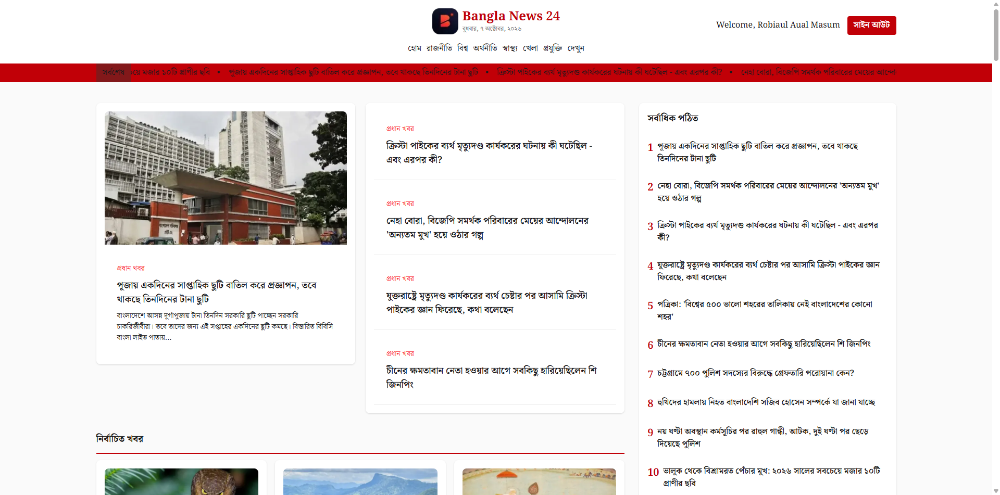

# 📰 Bangla News 24 — Your Source for News

**Bangla News 24** is a modern news website designed to help readers explore news and stay informed about current events. With a clean interface and organized news content, the project aims to make discovering and reading news simple and convenient.

🔗 **Live Demo:** [Visit Bangla News 24](https://bangla-news-24-iota.vercel.app/)

---

## 📸 Project Preview



---

## 📖 About the Project

Bangla News 24 is a web development project focused on delivering a user-friendly news browsing experience. It provides a foundation for presenting news content in an organized format, making it easier for readers to discover stories and explore different topics.

The project also demonstrates the use of modern web development technologies to build and deploy a web application.

## ✨ Features

* **📰 News Browsing** — Explore news content through a clean and organized interface.
* **📂 Organized Content** — Present news stories in a structured layout for easier navigation.
* **📖 News Details** — Provide a dedicated reading experience for individual articles
* **📱 Responsive Design** — Aim for a consistent browsing experience across desktop, tablet, and mobile devices.
* **⚡ Modern Web Experience** — Built with a modern web application framework.
* **🌐 Live Deployment** — Access the application online through Vercel.

## 🛠️ Technologies Used


| Technology                                    | Purpose                               |
| --------------------------------------------- | ------------------------------------- |
| [Next.js](https://nextjs.org/)                | Web application framework and routing |
| [React](https://react.dev/)                   | Building reusable UI components       |
| [TypeScript](https://www.typescriptlang.org/) | Type safety and maintainable code     |
| [Tailwind CSS](https://tailwindcss.com/)      | Styling and responsive layouts        |
| REST API / JSON                               | News data management, if used         |
| [Vercel](https://vercel.com/)                 | Application deployment and hosting    |

## 📦 Dependencies


* **next** — Next.js framework.
* **react** — React UI library.
* **react-dom** — React DOM rendering.
* **typescript** — TypeScript support.
* **tailwindcss** — Utility-first CSS styling, if configured.


## 🚀 Getting Started

Follow these steps to run the project locally.

### Prerequisites

Make sure you have installed:

* [Node.js](https://nodejs.org/)
* npm or another supported package manager
* [Git](https://git-scm.com/)

### 1. Clone the Repository

```bash
git clone https://github.com/Robiaul-Aual-Masum1313/Bangla-News-24.git
```

### 2. Navigate to the Project Directory

```bash
cd YOUR_PROJECT_FOLDER
```

Replace `YOUR_PROJECT_FOLDER` with your actual project directory name.

### 3. Install Dependencies

```bash
npm install
```

### 4. Configure Environment Variables

 `.env.local` file in the project's root directory.

```env
BETTER_AUTH_SECRET =
BETTER_AUTH_URL = 
BETTER_AUTH_GITHUB_SECRET_KEY = 
BETTER_AUTH_GITHUB_CLIENT_ID = 
BETTER_AUTH_GOOGLE_SECRET_KEY = 
BETTER_AUTH_GOOGLE_CLIENT_ID = 
BETTER_AUTH_MONGODB_URL = 
```

Skip this step if no environment variables are needed.

**Security:** Never commit private API keys or credentials to your public repository.

### 5. Run the Development Server

```bash
npm run dev
```

### 6. Open the Application

Visit http://localhost:3000 in your browser.

The application should now be running locally.

## 📜 Available Scripts


| Command         | Description                               |
| --------------- | ----------------------------------------- |
| `npm run dev`   | Starts the development server             |
| `npm run build` | Creates a production build                |
| `npm run start` | Runs the production server after building |


## 👨‍💻 Author

**Robiaul Aual Masum**

* GitHub: [Visit my GitHub profile](https://github.com/robiaul-aual-masum1313)

---

**Built with ❤️ using modern web technologies.**
